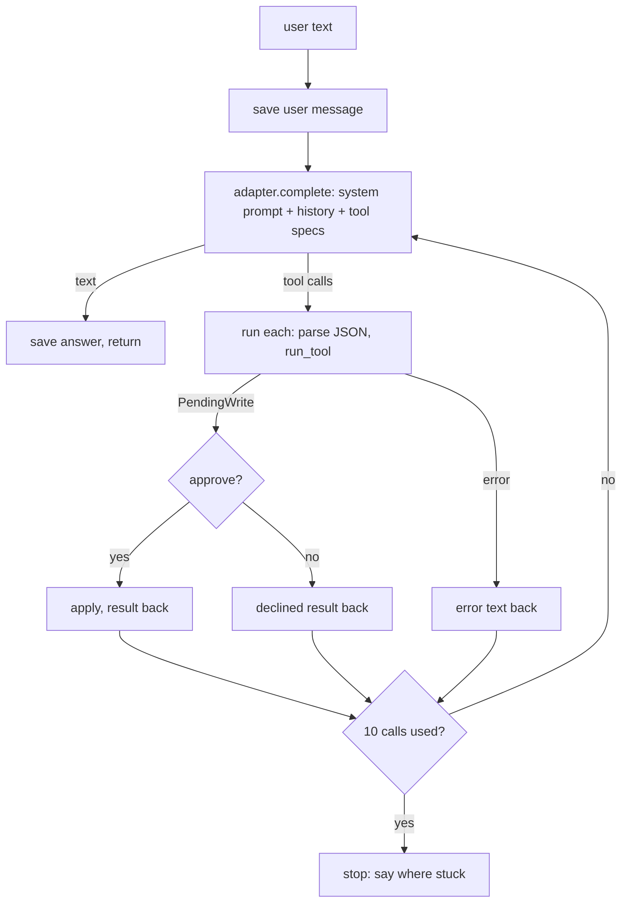

# Flow: ask a question

**Summary.** `ka chat` sends each message through `run_turn`: build the prompt, ask the model, run the tools it requests, feed results back, repeat until it answers. Risky writes pause the loop for a yes or no. Every message is saved to SQLite as it happens, so a crash or Ctrl-C loses nothing.

## Worked example: "Change my Acme title to Senior Engineer"

1. `chat.chat_loop` reads the line, calls `loop.run_turn` with the conversation id and `terminal_approve`.
2. `run_turn` builds the system prompt (`prompt.build_system_prompt`: rules, profile, guardrails, active memory) from `ctx.data`. It is rebuilt each turn and never stored, so edits to the data show at once.
3. `OpenAICompatAdapter.complete` sends system prompt, saved history (`Db.messages`) and the tool specs (generated from each tool's Pydantic model by `tool_specs`) to the provider. Retries cover 429, timeouts and 5xx only.
4. The model asks for `propose_change`. `_execute` parses the raw argument string with `json.loads`; bad JSON becomes a tool result, not a crash.
5. `registry.run_tool` validates and returns a `PendingWrite`. The loop emits an `approval` event; `terminal_approve` prints summary and diff and asks `[y/N]`.
6. Yes: `pending.apply()` commits through `writer.apply_change`. No: the model receives "user declined; nothing was changed". Either way the result is saved as a `tool` message and the loop calls the model again for the final text.

## Why this way

- **Raw JSON string from the adapter.** Models emit broken JSON sometimes; parsing in the loop turns that into feedback the model can fix.
- **System prompt not stored.** Guardrails and memory change; stored copies would go stale and bloat history.
- **Repair on read** (`Db._repair`): an interrupted turn leaves tool calls without results, which providers reject. Missing results are synthesised in memory, never rewritten on disk.
- **No agent framework:** the loop is ~100 lines, which is the learning goal. LangGraph is the pick if that changes.

## Failure cases

| Case | Result |
|---|---|
| Unknown tool, bad JSON, invalid args | tool result `error: ...`; model retries |
| Tool raises | `error: Type: msg`; loop continues |
| Approved write fails at apply | `failed: ...` back to model; nothing half-written |
| 10 tool calls used | later calls get "step limit reached"; answer says where it stopped |
| Provider down | `AdapterError` after retries; user message stays saved; chat continues |

Interview questions: [ask-question.interview.md](interview/ask-question.interview.md)
