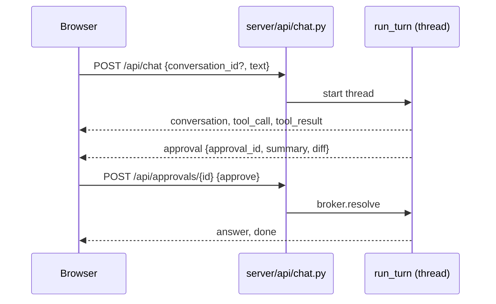

# Flow: chat (UI)

**Summary.** The browser posts a message to `POST /api/chat` and reads the reply as server-sent events. The agent loop runs in a worker thread; a write needs a yes or no from the browser through `POST /api/approvals/{id}` before anything is saved.

## Worked example

Owner types "relabel account A-01". The model calls `propose_change`; the loop emits an `approval` frame with the diff. The loop thread blocks in `ApprovalBroker.wait`. The owner taps Yes, the browser posts the answer, the thread resumes, `apply()` commits to the data repo, the model writes its answer, and the stream ends with `done`. Each tool result also writes one row to the activity log.

## Why this way

- **Loop unchanged.** The loop's `approve` callback is synchronous, so the web layer blocks a worker thread instead of changing the loop. Cost: one thread per running turn.
- **Answer arrives whole.** Adapters do not stream tokens. The UI types the answer out; reduced-motion users get it instantly.
- **No retry on stream errors.** A retry would send the owner's message twice.

## Failure cases

| Case | Result |
|---|---|
| Approval never answered (tab closed) | declined after `approval_timeout` (600 s) or when the stream closes; nothing written |
| Approval answered twice | second call gets 404; change applied once |
| Provider error (no credits, timeout) | `error` frame with the readable message; user message stays saved |
| Second turn in a running conversation | 409 |
| Unexpected exception | `error` frame "Something went wrong."; details stay in the server log |

Source: `server/api/{chat,approvals,describe}.py`, `ui/src/features/chat/*`, `ui/src/lib/stream.ts`

Interview questions: [chat.interview.md](chat.interview.md)
