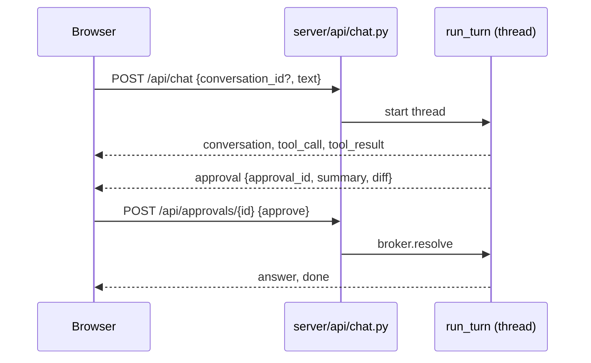

# Flow: chat (UI)

**Summary.** The browser posts a message to `POST /api/chat` and reads the reply as server-sent events. The agent loop runs in a worker thread; a write needs a yes or no from the browser through `POST /api/approvals/{id}` before anything is saved.

## Worked example

The person types "relabel account A-01". The model calls `propose_change`; the loop emits an `approval` frame with the diff. The loop thread blocks in `ApprovalBroker.wait`. They tap Yes, the browser posts the answer, the thread resumes, `apply()` commits to the data repo, the model writes its answer, and the stream ends with `done`. Each tool result also writes one row to the activity log.

## The Ka entity and the composer

One element, the Ka entity, changes shape per phase: a blob on the empty home, the composer's border while typing, a ring while thinking, a sliding bar while a tool runs, a halo while waiting for a yes. The composer's placeholder carries the status. Everything is measured from one bottom value so it lines up on iPhones, and the thread follows new text only while the reader is at the end. Details: [entity.md](entity.md).

## Why this way

- **Loop unchanged.** The loop's `approve` callback is synchronous, so the web layer blocks a worker thread instead of changing the loop. Cost: one thread per running turn.
- **Answer arrives whole.** Adapters do not stream tokens. The UI types the answer out; reduced-motion users get it instantly.
- **No retry on stream errors.** A retry would send the message twice.

## Private routing

With flag `private_routing` on, every tool registered with `private=True` (finance tools and `import_statement`) marks the conversation private in `ka.db` (`private_conversations`) the moment it runs. Tools whose result only sometimes holds finance data mark it themselves through `ctx.mark_private()`: `search` when a hit is in `accounts.yaml` or `rules/merchants.yaml`, `search_conversations` when a snippet comes from a private chat, and `propose_change` on accounts, merchant rules or type rules. `run_turn` then sends every later model call of that turn, and of every later turn in that conversation, to the private chain (`ChainAdapter` over `private_models`: OpenRouter with `zdr: true` today, Ollama first later). The chain tries its entries in order and never falls back to `models.default`; when all fail, the turn ends with a plain message: the chat holds finance data, so it only uses the private model, which is not available (with the reason), and a new chat works for other questions (`PrivateUnavailable`). Loading the finance toolkit makes a chat private only when its memory has entries, since that memory goes into the history; otherwise the first finance tool that returns data does it. The first question of a conversation still goes to the default model, because nothing private is known yet. `private_models` only accepts Ollama, or OpenRouter with `zdr: true`; `only: [amazon-bedrock]` pins OpenRouter to named providers (a live check showed `zdr` alone routing Claude Haiku to Google, whose endpoint may keep data under Safety retention).

- **Why per conversation, not per call.** Once amounts are in the history, every later call resends them; switching back would leak them.

## Failure cases

| Case | Result |
|---|---|
| Third chat turn of one account while two are running | 429 "Another chat is still answering. Try again in a moment."; other accounts unaffected |
| Approval never answered (tab closed) | declined after `approval_timeout` (600 s) or when the stream closes; nothing written |
| Approval answered twice | second call gets 404; change applied once |
| Provider error (no credits, timeout) | `error` frame with the readable message; user message stays saved |
| Second turn in a running conversation | 409 |
| Private chain down (for example an expired OpenRouter key) | `error` frame naming the reason and suggesting a new chat; default model not called |
| Web search off | the system prompt says so; the model answers that web search is off instead of offering to look things up |
| Unexpected exception | `error` frame "Something went wrong."; details stay in the server log |

Source: `server/api/{chat,approvals,describe,conversations}.py`, `ui/src/features/chat/*`, `ui/src/app/Sidebar.tsx`, `ui/src/lib/stream.ts`

Interview questions: [chat.interview.md](../interview/chat.interview.md)
