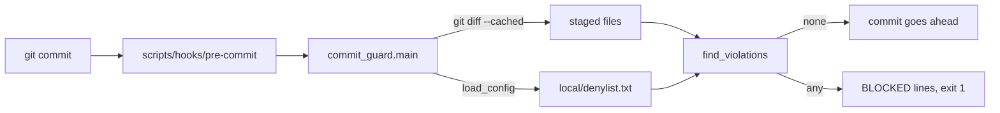

# Flow: commit guard

**Summary.** A git pre-commit hook runs `scripts/commit_guard.py` on every staged file and blocks the commit if it finds a `.env` file, a PDF, something shaped like an API key or private key, or any phrase from the owner's private denylist. The denylist lives outside the code repo, in the data repo's `local/denylist.txt`, so the list of personal words is never committed either. This keeps a public code repo free of personal data even when a test fixture or a debug print slips into a commit.

## Worked example

The repo sets `core.hooksPath` to `scripts/hooks`, so `git commit` runs `scripts/hooks/pre-commit`, which executes `uv run python -m scripts.commit_guard`. `main` lists staged files that were added, copied or modified (`git diff --cached --name-only --no-renames --diff-filter=ACM`) and reads each one's staged content with `git show :path`, so it checks what will be committed, not the working copy. It loads `config.yaml` to find `denylist_path`. `find_violations` then applies four rules to each file: a `.env` or `.env.*` name (except `.env.example`); a `.pdf` suffix, because compressed PDF text hides personal data from any text scan; the secret patterns (`sk-…`, Google `AIza…`, GitHub tokens, PEM private keys); and the denylist. Denylist matching ignores case and all whitespace on both sides, so "Jane Doe" also catches "janedoe" and "JANE\nDOE"; entries shorter than four characters are skipped to avoid blocking on common fragments. Each hit prints `BLOCKED <path>: <rule>: <detail>`, naming the denylist line number, never the word itself.

## Why this way

- **Denylist outside the repo.** A list of personal names committed to a public repo would leak exactly what it protects.
- **Staged content, not files on disk.** A partly staged file is checked as it will be committed.
- **Fail closed on config.** If the config cannot be read the guard blocks, because a guard that silently skips is worse than none. A missing denylist file only warns, so a fresh checkout can still commit code.
- **Never edit the denylist to pass** (`AGENTS.md`): fix the commit instead.

## Failure cases

| Case | Result |
|---|---|
| `.env` or a PDF staged | blocked: `env_file` / `pdf` |
| Key-shaped string in any staged file | blocked: `secret` |
| Denylist phrase in any staged file, any case or spacing | blocked: `denylist line N` |
| `config.yaml` missing or invalid | blocked: cannot load the denylist |
| `local/denylist.txt` missing | warning; secrets, `.env` and PDF rules still apply |
| Generated files staged by accident (for example a test cache) | blocked if they contain a denylist phrase; unstage and delete them |

Source: `scripts/commit_guard.py`, `scripts/hooks/pre-commit`

Interview questions: [commit-guard.interview.md](interview/commit-guard.interview.md)
