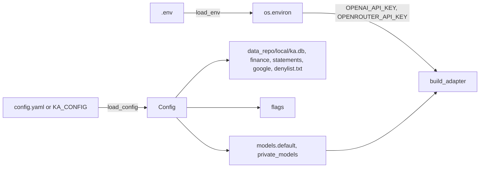

# Flow: config and secrets

**Summary.** `load_config` reads one `config.yaml` (or the file `KA_CONFIG` points at) into a strict `Config` model; everything else (data repo path, model choices, private model chain, feature flags, allowed UI hosts, Google settings) comes from it. Paths for the database, finance CSVs, statements, Google tokens and the denylist are all derived from `data_repo/local`, so personal state never sits in the code repo. API keys come only from the environment, filled from `.env` by `load_env`, and are never stored in config or logged.

## Worked example

`ka serve` first calls `load_env()` (`server/env.py`): each `KEY=value` line of `.env` goes into `os.environ`, and the file wins over a variable already exported in the shell, because a stale exported key would otherwise silently beat the one the owner just put in `.env`. `load_config` (`server/config.py`) then picks `config.yaml` in the working folder, or the path in `KA_CONFIG` (tests and smoke runs point this at scratch copies so the real data repo is never touched). Validation is strict: `data_repo` is expanded from `~`; a model with `zdr` or `only` must be an OpenRouter model; every `private_models` entry must be Ollama or OpenRouter with `zdr: true`, so money questions can never be routed to a provider that keeps data. The derived properties (`db_path`, `finance_dir`, `statements_dir`, `google_dir`, `denylist_path`) all sit under `data_repo/local`, which the data repo git-ignores. `build_adapter` reads the provider's key from the environment at call time and fails with `OPENAI_API_KEY not set` (or the OpenRouter equivalent) instead of sending an empty key.

Feature flags are plain booleans in `flags`; a missing flag means off, unknown names are rejected, and every check goes through `server.flags.is_on` (see `flags.md`). Settings shows the known flags read-only; they are changed only in the file. API keys are listed by name in `.env.example`.

## Model tiers

`Config.model_for(task)` picks a model by task type, not by another model: `chat` is `models.default`, `small` (nightly extraction, page summaries) and `grader` (eval judge) fall back to the default when not set. Finance chats and category suggestions keep using the private chain, because they carry finance data. OpenRouter-only options on a model: `zdr`, `only`, `fallbacks` (sent as the `models` list, so OpenRouter tries backups in order), `cache` (the system prompt becomes a text part with `cache_control: ephemeral`) and `reasoning` (`low|medium|high` thinking effort, e.g. on the private finance model). The adapter reads `usage.cost` and `prompt_tokens_details.cached_tokens` into `Usage`, and tracing records them.

## Why this way

- **One file, strict model.** A wrong key or value stops startup with a message instead of running half-configured.
- **Keys only in the environment.** Config can be shown in Settings and copied between machines without leaking secrets.
- **Private chain validated at load.** The zero-data-retention rule is enforced where the config is read, not trusted to whoever edits it.

## Failure cases

| Case | Result |
|---|---|
| No `config.yaml` and no `KA_CONFIG` | `ConfigError: config not found … Copy config.example.yaml to config.yaml` |
| Invalid YAML or unknown/wrong field | `ConfigError` naming the file and field |
| `private_models` entry without `zdr: true` or with `openai` | `ConfigError`; startup refused |
| API key missing when a model is called | `AdapterError: OPENAI_API_KEY not set`; the turn fails with that message |
| `.env` missing | ignored; keys must then be exported in the shell |

Source: `server/config.py`, `server/env.py`, `config.example.yaml`

Interview questions: [config.interview.md](interview/config.interview.md)
