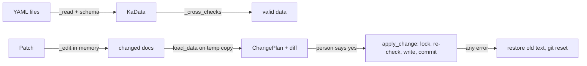

# Flow: data repo (load, validate, write)

**Summary.** Each account's career and memory data lives as YAML in its own folder (`users/<id>/`) of one private git repo; `load_data` reads all eleven files, validates each against a strict schema and then checks the rules that span files. Every write goes through `writer.py`: patch an in-memory copy, validate the whole repo on a temp copy, show a diff, then lock, re-check and commit, rolling back on any failure. So the repo is never left half-written or invalid, and every change is one git commit the owner can see.

## Per-user layout

Everything personal sits under `users/<user_id>/` in the data repo: the YAML files, `memory/core.yaml` plus one memory file per toolkit (`memory/finance.yaml`, `memory/movies.yaml`), `settings.yaml` (Drive folder and Sheet ids) and a git-ignored `local/` (finance CSVs, statements, Google token, intake uploads). The shared `local/ka.db`, `local/denylist.txt` (read by the commit guard) and the commit lock `.ka.lock` stay at the repo root; every commit from any account takes that one lock (`server/locks.py` `repo_lock`), so two accounts saving at once never collide in git. `server/users.py` `user_config(cfg, user_id)` returns a Config whose `data_repo` is the user folder and whose `repo_root` is the shared repo, so loaders and writers work on one user's folder unchanged; git commands run inside the subfolder. Folder names are the opaque account id (`u_` + 12 hex), never the username. At sign-up `start_user_space` copies `server/users_starter/` (valid empty files) into a new folder and commits it once; it never reuses an existing folder. Every account starts empty.

## Worked example

`ka check` calls `load_data(root)` in `server/integrations/data_repo/loader.py`. `_read` loads each file in `FILES` with ruamel's safe loader, turns bare YAML dates back into strings (`_plain`, because the schemas expect partial dates like `2024-02`), and builds the Pydantic model. Every model extends `KaModel` (`schemas/common.py`) with `extra="forbid"`, so a typo in a field name fails instead of being silently dropped. `_cross_checks` then enforces what no single file can: a highlight's domains exist in `jobs.yaml`, a merchant rule's category is in `categories.yaml`, a memory's `replaced_by` points at a real entry, and each `ids.yaml` counter is above the highest id in use. Any failure is one `DataRepoError` naming file, field and reason.

A write (chat `propose_change`, a Pending approval, an intake bundle) builds a `Patch` and calls `plan_change` or `plan_batch` (several patches, one commit). `_edit` applies it to in-memory documents and assigns new ids from `ids.yaml`; ids can never be set by the caller. `_finish_plan` refuses a file with uncommitted edits, copies the repo (minus `.git` and `local`) to a temp folder, writes the changes there and runs `load_data` on it, so an invalid change is rejected before anything touches the real repo. The diff it returns is what the approval card shows. On yes, `apply_change` takes a `fcntl` lock on `.ka.lock`, checks each file still has the text it had at proposal time, writes, validates the real repo once more (a hand edit since the proposal can break a cross-file rule), and commits only those paths.

## Why this way

- **Validate a copy, not the repo.** Validating after writing would leave a broken repo on failure; the temp copy makes rejection free.
- **Stale check plus lock.** Chat, the CLI and the web app can all write; the lock serialises them and the old-text check catches a change made between proposal and yes.
- **System-assigned ids.** The model never invents an id, so ids stay unique and counters stay ahead.

## Failure cases

| Case | Result |
|---|---|
| File missing, invalid YAML, unknown or wrong field | `DataRepoError` with file and field; `ka check` exits 1 (without `--user` it checks every account and names the one that failed), the web app reports it |
| Cross-file rule broken (unknown domain or category, counter too low) | `DataRepoError`; a write is refused before it lands |
| Target file has uncommitted edits | `ChangeError: <file> has uncommitted changes`; nothing written |
| File changed between proposal and yes | `ChangeError: <file> changed since proposal`; nothing written |
| Commit or validation fails mid-apply | old text restored, `git reset` on those paths, error raised |

Source: `server/integrations/data_repo/{loader,writer}.py`, `server/integrations/data_repo/schemas/*`

Interview questions: [data-repo.interview.md](interview/data-repo.interview.md)
