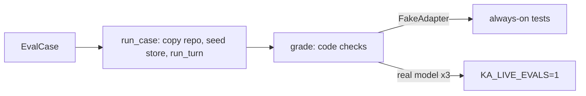

# Flow: evals

**Summary.** Twenty questions from the spec run through the real loop against a synthetic persona (fixture data repo plus a fixed October 2030 of transactions). Each case has code checks: tools called or not, exact amounts, guardrail ids, commits added. Deterministic tests prove the harness; opt-in live runs ask a real model three times per case and need two passes.

## Worked example: case 1

"How much did I spend in October 2030?" Expected, written before any run: `finance_summary` called, answer contains `153.50` (six purchases; the own transfer and loan payment are excluded). `persona.seed_store` plants the rows; `answer_cites_money` matches the number with commas stripped.

## Why this way

- **Code checks, not an LLM judge.** Amounts, ids and tool calls are exact; a judge adds cost and noise. A judge for resume quality comes later.
- **3 runs, 2 must pass.** Models vary; one run is an anecdote.
- **Scripted tests keep the harness honest** (checks can fail, good scripts pass) without spending money.
- **Real failures become tests:** a live miss is fixed in the prompt or tool text, or pinned as a deterministic loop test.

## Run

`KA_LIVE_EVALS=1 uv run pytest tests/evals/test_live.py -q` (add `KA_LIVE_LOCAL=1` for Ollama, `-k q06` for one case). Cost: up to 60 conversations.

## Results log

Fill in after each live run: model, date, passes per case.

Interview questions: [evals.interview.md](interview/evals.interview.md)
