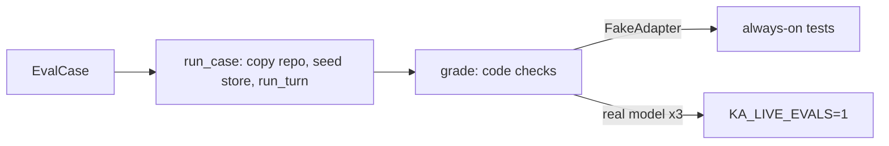

# Flow: evals

**Summary.** Twenty questions from the spec run through the real loop against a synthetic persona (fixture data repo plus a fixed October 2030 of transactions). Each case has code checks: tools called or not, exact amounts, guardrail ids, commits added. Deterministic tests prove the harness; opt-in live runs ask a real model three times per case and need two passes.

## Worked example: case 1

"How much did I spend in October 2030?" Expected, written before any run: `finance_summary` called, answer contains `153.50` (six purchases; the own transfer and loan payment are excluded). `persona.seed_store` plants the rows; `answer_cites_money` matches the number with commas stripped.

## Why this way

- **Code checks, not an LLM judge.** Amounts, ids and tool calls are exact; a judge adds cost and noise. A judge for resume quality comes later.
- **3 runs, a majority must pass; finance every run.** Models vary; one run is an anecdote, and a money answer that is right twice in three is wrong.
- **Scripted tests keep the harness honest** (checks can fail, good scripts pass) without spending money.
- **Real failures become tests:** a live miss is fixed in the prompt or tool text, or pinned as a deterministic loop test.

## Harness setup (next phase)

- **Clean environment.** `run_case` builds a fresh data repo per run with `make_repo` (the persona as `users/avery/`), a temp CSV store seeded by `persona.seed_store`, and an in-memory SQLite. The real data repo, CSV and Sheet are never touched.
- **Runs per case.** `EvalCase.runs` (default 3); `needed(case)` is a majority, or every run when `must_pass_all` is set. Finance cases (1-5, 15, 16, 19, 20) must pass every run.
- **Two sets.** `EvalCase.suite` is `regression` (must stay near 100%) or `capability` (starts low, climbs); pick one with `-m regression` / `-m capability`.
- **Code checks first, then the judge.** A case with a `rubric` is graded by `judge` (`tests/evals/judge.py`) only after its code checks pass, using `models.grader` (Opus): first line PASS or FAIL, then a reason. `judge_cases.py` holds about ten hand-graded answers to calibrate it (parked).
- **History.** Each live run appends rows to `tests/evals/results/<date>.jsonl` (git-ignored); `uv run python -m tests.evals.compare` lists cases that passed before and fail now. Run it before and after every prompt, model or tool change.

## Run

`KA_LIVE_EVALS=1 uv run pytest tests/evals/test_live.py -q` (add `KA_LIVE_LOCAL=1` for Ollama, `-k q06` for one case). Cost: up to 60 conversations.

## Results log

Fill in after each live run: model, date, passes per case.

Interview questions: [evals.interview.md](interview/evals.interview.md)
