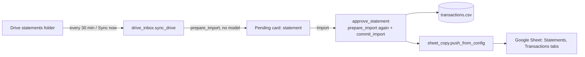

# Flow: Google (Drive inbox and Sheet copy)

**Summary.** The owner drops a statement PDF into a Drive folder from any device. Every 30 minutes, or on "Sync now", Ka downloads new PDFs, checks them with the normal model-free import, and queues one import card per file in Pending. Approved imports and recategorised rows are copied to a Google Sheet; the local CSV stays the source of truth, so Google being down only delays the copy.

## Worked example

1. Owner signs in once: Settings > Google > Connect (or `ka google login`). `oauth.GoogleAuth` runs the installed-app OAuth flow with PKCE; the loopback callback `http://127.0.0.1:<port>/api/google/callback` checks the `state` it issued, then stores the refresh token in `ka-data/local/google/token.json` (mode 0600). Scopes: `drive.readonly`, `spreadsheets`, `openid`, `userinfo.email`.
2. The `drive_sync` APScheduler job (`drive_inbox.drive_job`) calls `run_sync`, which builds `ApiDrive` (Drive API v3 through `google-api-python-client`) and lists PDFs in `google.drive_folder_id`.
3. For an unseen file id, `sync_drive` downloads it into `statements_dir` (temp file, then rename), runs `prepare_import`, and adds a `statement` card with period, row count, money in and out as text, check failures and `already_imported`. The file id goes into `app_state.drive_seen`, so a renamed file is not fetched again.
4. Import on the card calls `approve_statement`: it re-runs `prepare_import` on the stored file, so a stale preview is never written, then `commit_import`. In the background, `push_from_config` replaces both Sheet tabs with every stored row (`valueInputOption=RAW`, so `-12.30` stays text), and category suggestions run if that flag is on.

## Why this way

- **Direct APIs, not Google's MCP servers.** The Workspace MCP Developer Preview rejects Gmail accounts. `DriveClient` and `SheetsClient` are Protocols, so an MCP version can replace `ApiDrive` and `ApiSheets` later.
- **CSV first, Sheet as a copy.** Queries stay fast and offline; the Sheet is for viewing anywhere.
- **Whole-tab replace.** Recategorising changes old rows; rewriting the tab is simpler than diffing and recreates a deleted tab.

## Failure cases

| Case | Result |
|---|---|
| Not signed in, token revoked or expired | Settings shows "Not connected"; sync and copy record `reconnect Google` |
| Non-statement PDF in the folder | Skipped once with its reason in Settings; deleted locally |
| Same statement uploaded twice | `already_imported` is recomputed each time Pending loads; Import is disabled, and a server refusal closes the duplicate card |
| Two syncs at once (job and button) | One process lock; one card per file |
| Sheet deleted or tab renamed | Copy fails with a status line and an activity row; the CSV is untouched; the next copy recreates tabs |
| One file fails to download | listed as "will retry"; other files still become cards; that file is tried again next sync |
| Offline | "Google unreachable", not "reconnect": the sign-in stays and Settings keeps showing the last status |
| Two Sheet copies at once | one lock; the store is read inside it, so the newest copy wins |

Source: `server/integrations/google/{oauth,drive,sheets}.py`, `server/finance/{drive_inbox,sheet_copy}.py`, `server/api/google.py`, `ui/src/features/settings/GoogleSection.tsx`, `ui/src/features/pending/StatementCard.tsx`.
