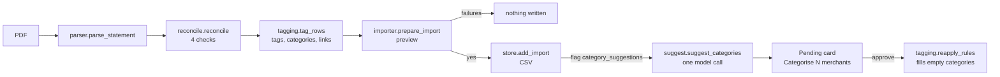

# Flow: import a statement

**Summary.** `ka import <pdf>` reads a Scotiabank chequing PDF with no model involved, proves the numbers are internally consistent, tags each row by rules, and shows a preview. Only after a yes does it append rows to the finance store. Nothing is written if any check fails or the statement was already imported.

## Worked example

A synthetic row `Mar 25  Point of sale purchase  4.50  495.50`, description `Apos Corner Cafe`.

1. `parser._lines` groups words into lines by vertical position. A line starting with a date at x 70-110 opens a row; a line with no date is the previous row's description (this also works across a page break).
2. `parser.parse_statement` reads the amount from the column its right edge falls in (`WITHDRAWN_X1` or `DEPOSITED_X1`) and the balance from `BALANCE_X1`. Column positions, not regex, because descriptions can contain amount-like text (`5.00 Railway`).
3. `reconcile.reconcile` computes `delta = balance - previous balance` (-4.50), so the signed amount is -4.50. The year comes from the statement period, which handles December to January.
4. `tagging.tag_rows`: type text `Point of sale purchase` gives `purchase`; merchant rule `Corner Cafe` gives category `dining`. Id is `scotiabank-chequing-2233-2031-04-001` (statement id plus row number), which is also the duplicate key.
5. `importer.commit_import` refuses on failures or a known `statement_id`; otherwise `CsvFinanceStore.add_import` appends.
6. With flag `category_suggestions` on, `cli._queue_suggestions` sends the uncategorised merchant texts (numbered lines) and, from `ka import` only, the unknown type texts to one model call in `server/finance/suggest.py`: the private chain when `private_routing` is on, otherwise `models.default`. An import approved in Pending suggests categories only. Code guards drop a category not in `categories.yaml`, a `match` under 4 characters or not inside the merchant text, and a tag outside `Tag`. Survivors become one bundle card per section (`categories`, `types`); a merchant whose text or match is already in a pending card is skipped. `ka suggest` does the same for every stored uncategorised spending row (backfill). Merchants already waiting in a card are not sent to the model again.
7. Approving the categories card commits the merchant rules (with today's `approved` date), then `tagging.reapply_rules` fills the category on stored rows that have none. A row with a category is never overwritten; own-account rows (`own_transfer`, `debt_payment`, `borrowing`) never get one.

## Why this way

- **Word positions over regex or `extract_table`.** The PDF has no ruling lines, and a description like `5.00 Railway` fools a text regex. Positions also give a fourth check for free: the printed column must agree with the direction the balance moved.
- **Running balance decides direction.** Printed columns could be misread; the balance cannot lie without breaking check 1.
- **Font-size filter.** Barcode digits sit inside the table area at other sizes (3.6, 6, 7, 10 pt). Table text is 8 and 9 pt.
- **CSV before Google Sheets.** Same columns as the planned sheet tabs, behind `FinanceStore`; the Google Sheet is a copy pushed by `sheet_copy.push_from_config`, never read back.
- **Corrections link one way.** Only the correcting row carries `linked_id`, so the store stays append-only.
- **Suggestions outside the import.** The parser and tagging path stays model-free and repeatable; the model only proposes rules, and the owner approves them once. Lines are numbered so a model that rewrites a merchant text still maps back to the right row.
- **New type rules do not re-tag stored rows.** Tags change totals the owner already saw; they apply from the next import.
- **Tag order.** Returned NSF and error correction are tagged first so a returned loan payment is never counted as borrowing. Then own-account match, then type rule, then fallback.

## Failure cases

| Case | Result |
|---|---|
| Scanned PDF | `no text layer` error, exit 1 |
| Other bank or layout | `not a Scotiabank chequing statement` |
| Any of the four checks fails | Each failure printed with row number; nothing written |
| Account not in `accounts.yaml` | Error naming last 4 digits; add the account and retry |
| Same statement again | `already imported`, exit 0 |
| Unknown type text | Tagged by direction, listed under `unknown types` |
| Unknown merchant | Category empty, counted under `uncategorised merchants`; suggested in Pending when the flag is on |
| Import and recategorise at the same time | `CsvFinanceStore` holds a file lock around each read-modify-write, so no rows are lost |
| Model down or unusable reply during suggestions | `suggestions skipped: ...`; the import itself is already written |

Drive inbox: see [google.md](google.md).

Interview questions: [import-statement.interview.md](interview/import-statement.interview.md)
