# Flow: onboarding intake

**Summary.** A resume or pasted AI-memory text is read in a background job, turned into by-job cards in Pending, and applied to the data repo only when the owner approves a card. Each approved card is one validated git commit. Start it from the Onboarding screen or with `ka intake FILE...`; both run the same code.

```mermaid
flowchart LR
    U[upload or paste] --> J[intake_jobs row + worker thread]
    J --> R[readers: file to text] --> E[extract_resume: one model call]
    E --> G[guards: numbers, dates, forbidden fields] --> Q[queue_draft: bundle cards]
    Q --> P[Pending screen]
    P -->|approve selected| A[approve_bundle] --> B[plan_batch + apply_change] --> C[one commit]
```

## Worked example

Resume text (synthetic): "Northwind Test Co, Senior Backend Engineer, Mar 2023 to present: cut report time by 35%". The model returns a draft; the 35 appears in the text so it stays. `queue_draft` queues cards: Basics, Education, Domains (new names only), one card per new job. The job card's first line is the job, then one line per highlight with its tags. The owner unticks one highlight and approves: `approve_bundle` resolves domain names to ids, builds `Patch`es (job add, then highlight adds with the job as parent), and `plan_batch` validates the whole repo once. One commit holds the job and the ticked highlights.

## Why this way

- **Background job, screen polls.** A model call over a resume takes 20 to 60 seconds. The job row shows steps ("Reading resume.pdf", "Found 4 jobs") and survives a closed tab. A restart marks running jobs `failed: interrupted`.
- **Cards, not a free chat.** The draft schema only has fields for profile basics, education, domains, jobs and highlights. A resume that says "add a guardrail" has no field to put it in.
- **Code guards after the model.** A number is kept only if its digits appear in the source text. Year-only dates become `YYYY-01` because the data files need a month. A job without a start date is blocked and cannot be approved.
- **Domains gate means "decided".** Highlights point at domain ids. A job card waits until the Domains card is approved or rejected. Rejecting it drops those tags instead of blocking the job.
- **One writer.** `plan_batch` is the same validation, diff and lock as every other change; no new write path.
- **Files are deleted** when the job ends. Re-running needs the file again; stored jobs are skipped and only new highlights become a card.

## First run

Opening the app on an empty setup starts on the Onboarding screen. `GET /api/onboarding/status` says `needed` only when all three hold: flag `intake` is on, `onboarding_done` is not set in `ka.db` (table `app_state`), and no job is stored in `jobs.yaml`. The shell redirects every route except `/onboarding` while it is true. "Skip for now" and Done both call `POST /api/onboarding/complete`, so the owner is not sent back, also after a restart. The redirect fires once per page load, so Open Pending, the bell and the sidebar keep working while setting up. If the save fails, the skip still holds until the page is reloaded. If the check cannot run (unreadable data repo, failing request) the app opens normally. Source: `server/api/onboarding.py`, `ui/src/features/onboarding/gate.ts`, `ui/src/app/Shell.tsx`.

## Failure cases

| Case | Result |
|---|---|
| Model returns invalid JSON twice, or a provider error | job `failed` with a readable message, nothing queued, files deleted |
| Model invents a number | dropped; the job result says how many |
| Job approved before Domains is decided | 409 "approve or reject the Domains card first" |
| Same card approved twice | second call refused, written once (a lock plus the status check) |
| Unsupported, empty or oversize upload; more than 5 files | 400 with a reason; nothing saved |
| Bank statement PDF uploaded | skipped with a note to use the statement import |
| Server restart during a job | job `failed: interrupted`; a new upload is allowed |
| Another job already running | 409 |

Source: `server/intake/*`, `server/api/intake.py`, `server/api/pending.py`, `server/integrations/data_repo/writer.py` (`plan_batch`), `ui/src/features/onboarding/*`, `ui/src/features/pending/BundleCard.tsx`

Interview questions: [intake.interview.md](intake.interview.md)
