# Flow: onboarding intake

**Summary.** The Onboarding screen collects basics, documents and pasted AI-memory exports without sending anything, then **Send to Ka** sends it all in one request. One background job reads it, turns it into by-job cards in Pending, and nothing reaches the data repo until the owner approves a card (one validated git commit each). `ka intake FILE...` runs the same reading code from the terminal (there a bad file fails the whole job; on the screen it is a warning).

```mermaid
flowchart LR
    S[Basics, Documents, Memory steps<br/>held in page state] -->|Send to Ka| U[POST /api/intake/onboarding]
    U --> J[intake_jobs row + worker thread]
    J --> R[readers: file to text] --> E[extract_resume: one model call]
    E --> G[guards: numbers, dates, forbidden fields] --> Q[queue_draft: bundle cards]
    Q --> P[Pending screen]
    P -->|approve selected| A[approve_bundle] --> B[plan_batch + apply_change] --> C[one commit]
```

## Worked example

Resume text (synthetic): "Northwind Test Co, Senior Backend Engineer, Mar 2023 to present: cut report time by 35%". The model returns a draft; the 35 appears in the text so it stays. `queue_draft` queues cards: Basics, Education, Domains (new names only), one card per new job. The job card's first line is the job, then one line per highlight with its tags. The owner unticks one highlight and approves: `approve_bundle` resolves domain names to ids, builds `Patch`es (job add, then highlight adds with the job as parent), and `plan_batch` validates the whole repo once. One commit holds the job and the ticked highlights.

## Why this way

- **Background job, screen polls.** A model call over a resume takes 20 to 60 seconds. The job row shows steps ("Reading resume.pdf", "Found 4 jobs") and survives a closed tab. A restart marks running jobs `failed: interrupted`.
- **Cards, not a free chat.** The draft schema only has fields for profile basics, education, domains, jobs and highlights. A resume that says "add a guardrail" has no field to put it in.
- **Code guards after the model.** A number is kept only if its digits appear in the source text. Year-only dates become `YYYY-01` because the data files need a month. A job without a start date is blocked and cannot be approved.
- **Domains gate means "decided".** Highlights point at domain ids. A job card waits until the Domains card is approved or rejected. Rejecting it drops those tags instead of blocking the job.
- **One writer.** `plan_batch` is the same validation, diff and lock as every other change; no new write path.
- **Files are deleted** when the job ends. Re-running needs the file again; stored jobs are skipped and only new highlights become a card.

## Send once

`OnboardingPage` keeps one `Draft` (basics, files, memory boxes) in React state; Next and Back only change the step, and no request goes out. The Send step lists what will go and to which provider. `draft.toForm` builds one multipart body (files, `basics` JSON when filled, `memory` JSON when any box has text) for `POST /api/intake/onboarding`, which starts one `onboarding` job: `runner.run_onboarding_job` queues the basics, extracts every document (a bad file is a warning), drops the resume's Name line when the owner typed a name, then reads each memory export. It fails only when nothing at all was produced. The result carries `jobs`, `highlights` and `memories` for the summary line.

The Send step is one continuous object (the `living-transitions` skill): the **Send to Ka** button becomes the Ka ring. `features/onboarding/KaRing.tsx` (mounted in the Shell) draws it on one canvas in the Shell with one render loop; `StepSend` only changes its target through a ref, and every value eases inside the loop (`ring.approach`), so nothing restarts or swaps. Phases: the ring takes the button's exact shape, rounds into the 112 px ring at the stage centre, and splits into one arc per part Ka reads (basics, each file, each assistant). Each arc is bound to that part's real state from the job (`result.parts`: waiting, reading, done, failed): the arc being read pulses, finished arcs stay lit, failed ones dim; the whole ring breathes on a 3.2 s cycle while Ka reads. When the job is done (at least 900 ms after Send, so it never flashes) the arcs join into one ring and the number of cards queued (`result.cards`) counts up inside it, with the summary below. **Review in Pending** shrinks the ring onto the Pending bell's badge (labelled with the count that badge shows), where the real badge takes over (with nothing waiting it simply fades), while Pending fades in behind and its cards rise one by one. A failure morphs the ring back into the button. Reduced motion snaps every change. Leaving with unsent input asks first (`beforeunload`, and a confirm on Skip); nothing is kept in the browser.

## Memory from several assistants

The Memory step takes up to 5 pasted exports, one box per assistant (Claude, ChatGPT, Gemini, other); they go with Send to Ka in the same request as everything else. Each source is read in turn with `memory_import.import_memory`. Items already queued in this run are listed to the model as "just imported" for the next source, so the same fact told differently by two assistants is kept once; each item carries `import:<assistant>` as its source. A source the model cannot read becomes a warning and the others continue; in a memory-only run the job fails only when every source fails. Terminal: `ka intake --memory a.txt --source claude --memory b.txt --source chatgpt`.

## First run

Opening the app on an empty setup starts on the Onboarding screen. `GET /api/onboarding/status` says `needed` while Ka knows nothing about the owner: flag `intake` is on, the data repo has no profile name, education, job or memory entry, and no sent onboarding is still running or waiting in Pending (`reason: "pending"`, so a reload after Send does not reopen setup). Statement cards and category or type suggestion cards do not count as waiting. It is read from the data, not a one-time flag: skipping, or rejecting every card, brings setup back on the next load. Finance rows do not count, since they say nothing about who the owner is. The shell redirects every route except `/onboarding` while it is true, once per page load, so Skip, Open Pending, the bell and the sidebar keep working. The chat home shows a "Set up Ka" card while `needed` and a plain prompt otherwise; it has no suggestion pills. If the check cannot run (unreadable data repo, failing request) the app opens normally. Source: `server/api/onboarding.py`, `ui/src/features/onboarding/gate.ts`, `ui/src/app/Shell.tsx`.

## Failure cases

| Case | Result |
|---|---|
| Model returns invalid JSON twice, or a provider error | job `failed` with a readable message, nothing queued, files deleted |
| Model invents a number | dropped; the job result says how many |
| Job approved before Domains is decided | 409 "approve or reject the Domains card first" |
| Same card approved twice | second call refused, written once (a lock plus the status check) |
| Unsupported, empty or oversize upload; more than 5 files | 400 with a reason; nothing saved |
| Bank statement PDF uploaded | skipped with a note to use the statement import |
| Server restart during a job | job `failed: interrupted`; a new upload is allowed |
| Another job already running | 409 |
| One of several memory sources fails | warning in the job result; the other sources are still queued |
| A document or a memory source fails in the onboarding send | warning on the summary; the rest is queued; the job fails only if nothing was produced |
| Send pressed twice, or another job running | 409; the button is disabled while sending |

Source: `server/intake/*`, `server/api/intake.py`, `server/api/pending.py`, `server/integrations/data_repo/writer.py` (`plan_batch`), `ui/src/features/onboarding/*`, `ui/src/features/pending/BundleCard.tsx`

Interview questions: [intake.interview.md](intake.interview.md)
