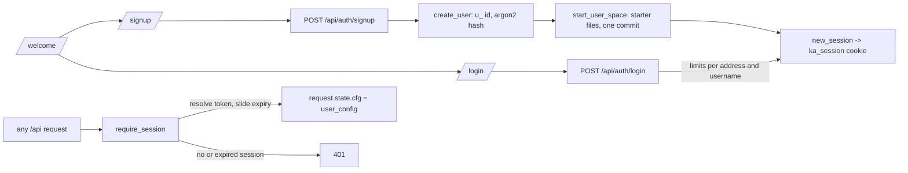

# Flow: accounts, sign-up and login

**Summary.** Ka is a platform: anyone who can reach it creates an account on the home screen, goes through onboarding, and signs in later from any device with a username and password. Each account gets an opaque id (`u_` + 12 hex), its own folder `users/<id>/` in the shared data repo and its own SQLite rows; a server-side session in an HttpOnly cookie decides which account every `/api` request acts for. Auth lives in `server/auth/` so JWT or an outside provider can replace it later.

## Worked example

A new person opens Ka. `Shell` sees no signed-in user and sends them to `/welcome` (`ui/src/features/auth/WelcomePage.tsx`): the empty-chat Ka entity, **Create account** and **Sign in**. Create account opens `/signup` (step 1 of 6; the onboarding page shows steps 2 to 6). `POST /api/auth/signup` (`server/api/auth.py`) counts the attempt against the address (5 per hour), then `create_user` (`server/auth/users.py`) checks the username rule, stores an Argon2id hash (`argon2-cffi`) under a random id, and answers "that username is taken" for a duplicate. `start_user_space` (`server/users.py`) copies `server/users_starter/` into `users/<id>/` and commits it under the repo lock; if that fails, the user row is deleted again. `on_user_created` adds the account's built-in loop tasks, and `new_session` sets the cookie: `secrets.token_urlsafe(32)`, only its SHA-256 stored, `HttpOnly; SameSite=Lax; Path=/`, plus `Secure` except on plain `http://localhost`.

Each later request passes `require_session` (`server/auth/middleware.py`): `resolve` refuses a session idle 14 days or older than 30, otherwise slides `expires_at`. The middleware puts `user_config(base, user)` on `request.state.cfg`; `get_cfg` and `get_db` (`server/api/deps.py`) give routes that account's folder and a `Db` scoped to it. `Db` refuses an empty user id; only `Db.system` (auth, migrations, account listing) sees no account. CLI commands take `--user USERNAME` (needed once there are several accounts); `ka users list` and `ka users reset-password USERNAME` are for the operator.

## In the UI

`/welcome`, `/signup` and `/login` sit behind `SignedOut` (signed-in people go to `/chat`); everything else sits behind `Shell` (signed-out people go to `/welcome`). Sign-up and sign-in share `AuthFrame.tsx`, the app's own header and screen frame, and each links to the other. On phones the buttons sit at the bottom inside the safe area, inputs are 16px so iOS does not zoom, and `autocomplete` lets the Keychain save and fill the password. Rules (`min_password`, `username_rule`) come from `/api/auth/status`. After sign-in or sign-up the query cache is cleared. A 401 calls `onUnauthorized` (`session.ts`): the path and unsent text are saved with the username and given back only to that same account after it signs in.

## Why this way

- **Opaque ids, not usernames, for folders and rows.** A recycled username never inherits an old folder, and paths do not reveal names.
- **Server-side sessions, not JWT.** Logout and expiry are a row delete.
- **Limits per address and username.** Five wrong passwords block that pair for 15 minutes, and one address may try 20 sign-ins in 10 minutes. There is no block per username alone (an earlier 50-an-hour one was removed), so nobody can lock another person out by guessing at their name. uvicorn reads `X-Forwarded-For` only from the local tailnet proxy and keeps the proxy's own (last) entry; `client_ip` (`server/auth/clientip.py`) then sees that address.
- **Session housekeeping.** Signing in replaces any session cookie already on the device; an hourly job (`purge_expired`) deletes expired sessions; `POST /api/auth/logout` deletes the current one.

## Failure cases

| Case | Result |
|---|---|
| No or expired cookie on `/api/*` | 401 `not signed in`; the UI goes to login and keeps the unsent text for the same account |
| Username taken | 409 `that username is taken` |
| Sixth sign-up from one address within an hour | 429 |
| Five wrong passwords from one address | 429 for that address and username for 15 minutes; other addresses still work |
| 21st sign-in attempt from one address within 10 minutes | 429 |
| Folder for the new account cannot be made | 500, the account row is removed, nothing half made |
| Another account signs in on the same tab | earlier account's saved place and draft are dropped |
| CLI with several accounts and no `--user` | `error: several accounts: pass --user USERNAME`; `ka check` instead checks every account, one line each, and exits 1 if any fails |

Source: `ui/src/features/auth/*`, `ui/src/app/Shell.tsx`, `ui/src/app/routes.tsx`, `server/auth/*`, `server/api/auth.py`, `server/api/deps.py`, `server/users.py`, `server/cli.py`
