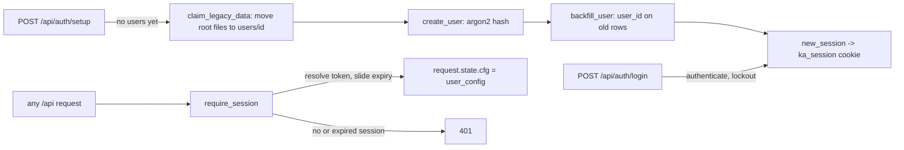

# Flow: login and user ID

**Summary.** Ka has one account, created as the first step of onboarding; after that the owner signs in with a username and password and gets a server-side session in an HttpOnly cookie that slides forward while used, up to 30 days. Every `/api` route needs that session, and the signed-in user decides which data folder (`users/<id>/`) and which SQLite rows a request sees. Auth lives in `server/auth/` so JWT or an outside provider can replace it later.

## Worked example

First visit: `GET /api/auth/status` says `setup_needed: true`, so the UI opens the account step. `POST /api/auth/setup` (`server/api/auth.py`) checks the username and password rules, then `claim_legacy_data` (`server/users.py`) moves the old root-layout YAML into `users/<id>/` with one commit and moves `local/` data; it refuses untracked personal files and rolls the repo back if any step before the commit fails. Only then is the user row written (`server/auth/users.py`, Argon2id through `argon2-cffi`), so a refused move (dirty repo) leaves no half-made account. `backfill_user` stamps the new id on every older SQLite row. `new_session` makes `secrets.token_urlsafe(32)`, stores only its SHA-256, and the cookie goes out `HttpOnly; SameSite=Lax; Path=/`, plus `Secure` everywhere except plain `http://localhost`.

Each later request passes `require_session` (`server/auth/middleware.py`): `resolve` finds the hash, refuses it once idle for 14 days or 30 days old, and otherwise moves `expires_at` forward (written at most once a minute). The middleware puts `user_config(base, user)` on `request.state.cfg`; `get_cfg` and `get_db` in `server/api/deps.py` hand routes that user's folder and a `Db` scoped to that user. CLI commands take `--user` (default: the only account) and background jobs run as the only account, resolved at run time.

## In the UI

`Shell` asks `/api/auth/status` first: no account yet shows `SetupStep` (step 1 of 6 of onboarding; the onboarding page shows steps 2 to 6), signed out goes to `/login` (`ui/src/features/auth/LoginPage.tsx`). Both screens share `AuthFrame.tsx`: the app's own header and screen frame with an onboarding page in it, so nothing moves when the signed-in app takes over; on phones the button sits at the bottom. The button is never disabled: a send with bad input shows why, and the message clears on the next keystroke. The password minimum and username pattern come from `/api/auth/status` (`min_password`, `username_rule`), so the form uses the server's rules. `/login` with no account yet goes to `/chat`, where the Shell shows account setup. Any 401 from `lib/api.ts` or the chat stream calls `onUnauthorized` (`ui/src/features/auth/session.ts`): it saves the current path and the composer's unsent text in `sessionStorage`, shows the login screen, and after sign-in returns to that path with the text back in the composer. Settings has Sign out.

## Why this way

- **Server-side sessions, not JWT.** Logout and expiry are a row delete; nothing to revoke on the client.
- **Setup closes after one account.** No public sign-up page; a second account would need a command later.
- **Lockout per username plus a per-client limit.** Five wrong passwords lock the name for 15 minutes; 20 attempts per 10 minutes per client address. The error never says whether the username exists.

## Failure cases

| Case | Result |
|---|---|
| No or expired cookie on `/api/*` | 401 `not signed in`; the UI returns to login and keeps the unsent message |
| Setup after an account exists | 409 |
| Data repo has uncommitted changes at setup | 409 with the reason; no account created |
| Five wrong passwords | 401 `locked, try again later` for 15 minutes |
| CLI with no account | `error: no account yet: run ka serve and create it in onboarding` |

Source: `ui/src/features/auth/*`, `ui/src/app/Shell.tsx`, `server/auth/*`, `server/api/auth.py`, `server/api/deps.py`, `server/users.py`, `server/store/migrations.py`
