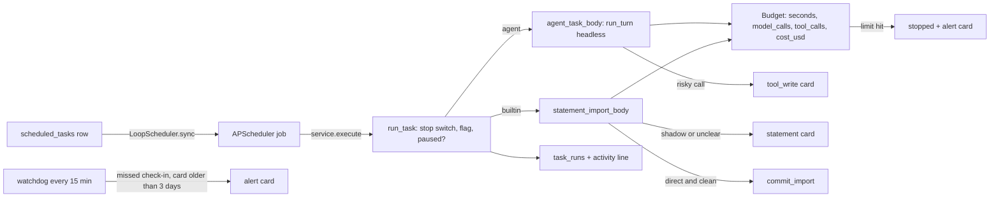

# Flow: loops (scheduled tasks)

**Summary.** A loop is a saved scheduled task that Ka runs on its own: a trigger (an interval, a daily or weekly time, or a folder check), a brief, the toolkits it may use, its checks and hard limits. Every task shares one scheduler, one runner with limits on time, model calls, tool calls and cost, and one run log in SQLite. New loops start in shadow mode, so every change they want to make waits in Pending; a stop switch pauses all of them, and a watchdog raises an alert when a run is missed or a card waits too long.

## Worked example: statement import

When the server starts with `loops` on, `_start_loops` (`server/api/app.py`) makes sure each account has the built-in task `<user>:statement_import` (`server/loops/builtin.py`: folder trigger every 180 minutes, shadow mode) and `LoopScheduler.sync` (`server/loops/triggers.py`) adds one APScheduler job per active task; a daily or weekly trigger runs in the account's own time zone (`profile.timezone`). Creating, pausing or deleting a task in the UI, or an approved `schedule_task`, calls `triggers.notify`, so no restart is needed. When the job fires, `service.execute` loads the task and calls `run_task` (`server/loops/runner.py`), which first checks the flag, the stop switch (`app_state` `loops_paused`) and the task's status. `statement_import_body` lists the Drive folder; for each file it skips write keys already claimed (`task_writes`, key `drive:<file id>`), downloads and parses the PDF, makes the card or the import, and only then claims the key, so a network error or crash is retried next run; on the retry a waiting card is found by its key and an import that landed shows as already imported, so nothing is done twice. Without Google connected the run is a quiet no-op; without a Drive folder for this account it records "Your Google Drive folder is not set up yet"; and a failing task keeps one open alert, not one per run. In shadow mode every new file becomes a statement card; in direct mode a statement whose checks pass, that is not already imported and has no unknown type texts is imported at once and copied to the Sheet; anything else still becomes a card. The run's counts and result go to `task_runs`, the task checks in, and an activity line records the outcome.

## Agent tasks

A task Ka or the person creates (`schedule_task`, risky, approved in chat; or `POST /api/loops`) runs its brief through the normal `run_turn` in a fresh conversation with only its toolkits loaded; with `private_routing` on, finance data moves it to the private chain like a chat. The loop passes `queue_risky`, so no one is asked mid-run: every risky call, `remember` included, becomes a `tool_write` card with its diff (marked `after_untrusted` when outside text was read), and approving it in Pending re-runs the tool on current data and applies it (`approve_tool_write`). `BudgetAdapter` counts every model call and its cost against the limits; tool calls are counted through the loop's events.

## Limits and switches

| Item | Default / where |
|---|---|
| Run limits (`RunLimits`) | 300 s, 20 model calls, 30 tool calls, $0.50 per run; a hit stops the run with an alert |
| Stop switch | Settings or `ka loops pause` (`app_state loops_paused`); flag `loops` off stops everything |
| Watchdog | every 15 min: a task with no check-in for twice its interval (daily: 26 h) or a card older than 3 days raises one alert, never twice for the same key |
| Shadow to direct | manual, per task; the loops screen shows approved and rejected card counts |

## Why this way

- **One runner for every loop.** Limits, the run log and the stop switch are written once.
- **Shadow first.** A new loop earns direct writes by being right for a while.
- **Write keys.** A crash between "imported" and "logged" cannot double rows.

## Failure cases

| Case | Result |
|---|---|
| Body raises | run `failed` with the exception type only; alert card |
| Limit hit | run `stopped`, reason names the limit; alert card |
| Stop switch on / task paused / flag off | run `skipped` with the reason |
| Bad trigger | refused at creation by APScheduler's own trigger check (`interval` at least 15 minutes); a bad stored one is skipped, never stops the scheduler |

**UI.** `/loops` (`ui/src/features/loops/*`, linked from the drawer and Settings when `loops` is on) lists tasks with their trigger, next run, last run, approval counts and a hint when a shadow task has five approvals and no rejections; it creates, pauses, deletes (not built-ins), switches shadow/direct (with a confirm), runs now and shows runs. Settings has the Pause all loops switch. Pending shows `tool_write` and `alert` cards (`ui/src/features/pending/LoopCards.tsx`).

Source: `ui/src/features/loops/*`, `ui/src/features/pending/LoopCards.tsx`, `server/loops/*`, `server/api/loops.py`, `server/toolkits/core/schedule.py`, `server/memory/pending.py`, `server/api/app.py`, `server/cli.py`
