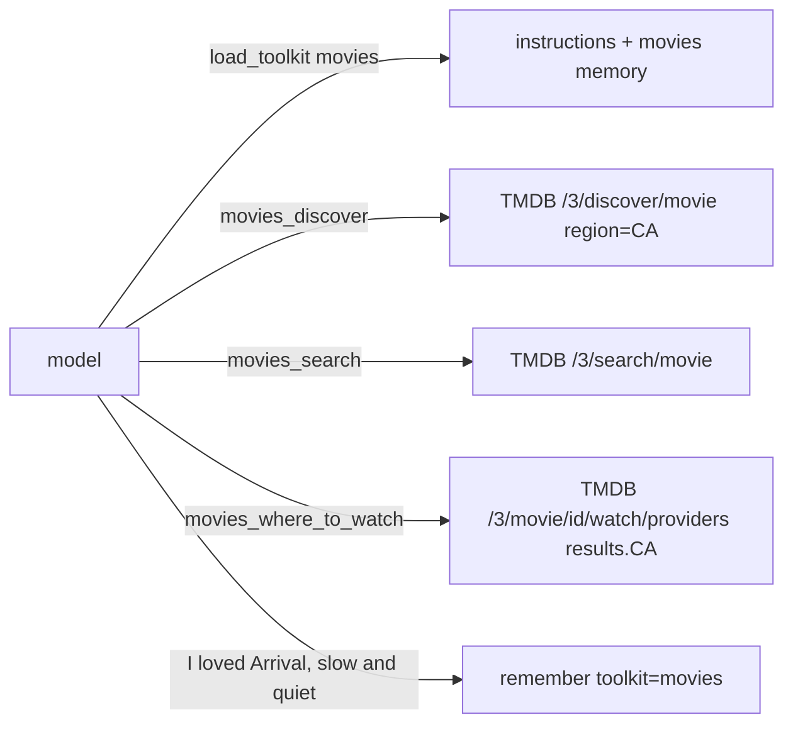

# Flow: movies toolkit

**Summary.** Behind the `movies` flag, a toolkit Ka loads when a request is about films: it learns the owner's taste from what they say in chat (saved to `users/<id>/memory/movies.yaml`), finds new and recent releases on TMDB, and checks where a film can legally be watched in Canada. TMDB's where-to-watch data comes from JustWatch, and every answer credits both. Scoring candidates with the owner's Entertainer taste model is a later step.

## Worked example

"Anything new I'd like this month?" The model loads `movies`; `load_toolkit` returns `instructions.md` and the active taste entries from the movies memory file. It calls `movies_discover` (`server/toolkits/movies/tools.py`), which uses `TmdbClient.discover` (`server/integrations/tmdb.py`): Bearer read-access token from `TMDB_API_TOKEN`, `region=CA`, `primary_release_date.gte` (default a year back), `with_genres`, newest first, at least 20 votes. For a pick, `movies_where_to_watch` reads `results.CA` (`flatrate`, `rent`, `buy`, `link`). All three tools are untrusted (overviews are outside text), so risky tools are blocked for the rest of the turn; saving a new taste happens on the owner's next message or through `propose_memory`.

## Why this way

- **TMDB over scraping.** A documented API with Canadian availability; web search covers what it lacks.
- **Taste as memory entries**, not a new schema: liked, disliked and why fit the existing memory file.

## Failure cases

| Case | Result |
|---|---|
| Flag off | toolkit not listed; `load_toolkit movies` refused |
| No `TMDB_API_TOKEN` | `movies need TMDB_API_TOKEN in .env` |
| Film not available in Canada | empty lists and the TMDB link |

**Open question for the owner:** TMDB's terms restrict use of its data with AI applications. Read them (or ask TMDB) before turning the flag on.

Source: `server/toolkits/movies/*`, `server/integrations/tmdb.py`
