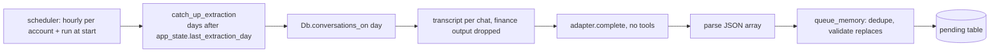

# Flow: nightly extraction

**Summary.** `ka extract` reads one day's saved conversations, asks the model what lasting facts the person revealed, and queues them as pending. Nothing reaches memory until that person approves. With the `nightly_extraction` flag on, `ka serve` runs it every hour for every account, catching each one up to its own local yesterday (never past the server's yesterday, because messages are stamped in server time); `ka --user NAME extract` still runs one day by hand.

## Worked example

Chat on 2031-04-05: "I moved to Lisbon". `extract_memories` builds the transcript (`_transcript`), lists active memories with ids in the instruction, and calls the model once per conversation so each pending item keeps its `source` conversation id. The reply is parsed by slicing from the first `[` to the last `]` (models wrap JSON in prose or fences). Each item goes through `pending.queue_memory`; duplicates of active memory or of an already queued item are skipped; `replaces` must name an active memory.

Scheduling: `create_app` (only when `ka serve` passes `start_scheduler=True`) registers an hourly APScheduler job and a one-time run at start, both wrapped in `for_each_account` (`server/jobs.py`): each account runs in its own `user_config`, under its own lock, and one account failing is logged without stopping the others. `nightly_job` calls `catch_up_extraction` with the account's local today (`users.local_today`, from `profile.timezone`), so it runs each day after that account's `last_extraction_day` up to its local yesterday, at most 7, and records each finished day; a day never runs twice. With no record yet it runs yesterday only.

## Why this way

- **APScheduler in the server, not cron.** The job needs the same config and database as the app, and must catch up after the laptop slept; `coalesce` runs a missed slot once.
- **Catch-up off the boot path.** It runs in the scheduler thread, so a slow or missing model never delays the server or stops it from starting.

- **Finance tool output never leaves the machine through this path.** The transcript replaces results of finance tools with a placeholder, because extraction may use a cloud model.
- **Model names the contradiction, code checks it.** The model sees ids and says which one a new fact replaces; code only verifies the id exists and is active.
- **One call per conversation, not per day.** Source accuracy beats a few cents.

## Failure cases

| Case | Result |
|---|---|
| Reply is not JSON | 0 queued, no crash |
| `replaces` names unknown or retired id | item dropped, warning logged |
| Provider down for a conversation | others continue; then `AdapterError`, so the day is not recorded and is retried. Chats that succeeded are listed in `app_state` `extraction_done:<day>` and skipped on the retry (and on a manual `ka extract` of that day), so no reworded duplicates |
| Flag off | `ka extract` exits 2 with a message; no schedule |
| Any failure in a scheduled run (key missing, provider down, data repo unreadable) | activity line `extraction failed: ...`, day not recorded, retried next run |
| Private conversation (routing on) | extracted only by the private chain; an item containing a digit is dropped, because approved memories reach every system prompt |
| Server off for weeks | only the last 7 days are extracted |

Interview questions: [nightly-extraction.interview.md](interview/nightly-extraction.interview.md)
