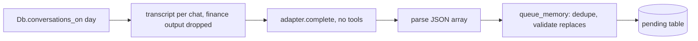

# Flow: nightly extraction

**Summary.** `ka extract` reads one day's saved conversations, asks the model what lasting facts the owner revealed, and queues them as pending. Nothing reaches `memory.yaml` until the owner approves. It runs behind the `nightly_extraction` flag; a scheduler will call it once the server exists.

## Worked example

Chat on 2031-04-05: "I moved to Lisbon". `extract_memories` builds the transcript (`_transcript`), lists active memories with ids in the instruction, and calls the model once per conversation so each pending item keeps its `source` conversation id. The reply is parsed by slicing from the first `[` to the last `]` (models wrap JSON in prose or fences). Each item goes through `pending.queue_memory`; duplicates of active memory or of an already queued item are skipped; `replaces` must name an active memory.

## Why this way

- **Finance tool output never leaves the machine through this path.** The transcript replaces results of finance tools with a placeholder, because extraction may use a cloud model.
- **Model names the contradiction, code checks it.** The model sees ids and says which one a new fact replaces; code only verifies the id exists and is active.
- **One call per conversation, not per day.** Source accuracy beats a few cents.

## Failure cases

| Case | Result |
|---|---|
| Reply is not JSON | 0 queued, no crash |
| `replaces` names unknown or retired id | item dropped, warning logged |
| Provider down | that conversation skipped, others continue |
| Flag off | `ka extract` exits 2 with a message |

Interview questions: [nightly-extraction.interview.md](nightly-extraction.interview.md)
