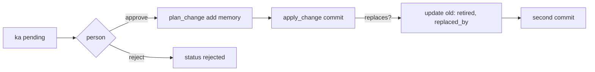

# Flow: review pending

**Summary.** `ka pending` lists queued memories and intake cards (`approve ID` applies an intake card's selected lines as one commit, see [intake.md](intake.md)); `approve <id>` writes one to `memory/<toolkit>.yaml` (core facts in `memory/core.yaml`) as a validated git commit, `reject <id>` discards it. A contradiction approval adds the new entry first, then retires the old one with `replaced_by` pointing at the new id. Statement cards from Drive are listed but approved or rejected only in the web Pending screen.

## Worked example

Pending 4: "Prefers hybrid roles", replaces M-0001. `approve_pending` builds a `Patch(target=memory, op=add)`; `writer.plan_change` assigns M-0002, validates the whole repo, `apply_change` commits. The item is marked approved right after that commit so a failure in step two cannot queue it twice. Step two updates M-0001 (`status: retired`, `replaced_by: M-0002`) as a second commit.

## Why this way

- **Two commits, not one.** `writer` edits one target per change; keeping that contract beats a special multi-record patch. Cost: if the second fails, the new entry exists and the old stays active; the error says so.
- **Same writer as `remember`.** Dirty files, stale plans and validation behave identically everywhere.

## Failure cases

| Case | Result |
|---|---|
| A memory file has uncommitted edits | error, item stays pending |
| Item already handled or unknown id | error, exit 1 |
| Retire step fails | new entry kept, error names the old id |

Interview questions: [review-pending.interview.md](interview/review-pending.interview.md)

**Toolkit memory.** A memory card carries `toolkit` (default `core`); approval writes it to `memory/<toolkit>.yaml` with the same retire-and-replace rule, and `replaced_by` must point inside the same file. Ids share the one `M` counter, so they stay unique across files.
