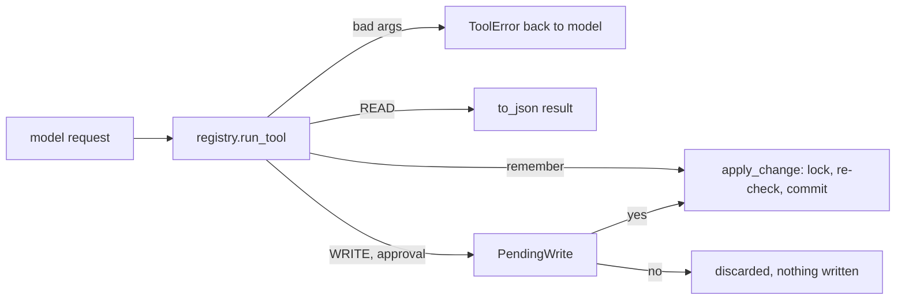

# Flow: tools

**Summary.** The agent never touches files; it calls named tools through one registry. Each tool validates its arguments with Pydantic, returns plain JSON (money as strings), and READ tools just answer. A WRITE tool that needs approval returns a `PendingWrite` (summary, diff, `apply`) so the loop can show it and write only after a yes.

## Worked example: add a highlight

Request `propose_change {target: highlight, op: add, parent: "Acme Widgets|2022-03", fields: {text, domains}}`.

1. `registry.run_tool` builds `Patch` (`writer.py`); a wrong field name fails here and the message goes back to the model.
2. `writer.plan_change` loads `jobs.yaml` and `ids.yaml` with ruamel.yaml in round-trip mode (keeps comments, quotes and flow style, so the diff shows only the real change), appends the record, and takes the next id from `ids.yaml` (`H-005`; the counter is bumped in the same plan, which is how ids are never reused).
3. It copies the repo to a temp folder, writes the new texts, and runs `load_data` there. Unknown domain, duplicate job and similar mistakes fail now, with the real repo untouched.
4. It returns a diff built with `difflib.unified_diff`, held in memory. A "no" leaves nothing to undo.
5. On yes, `apply_change` takes `flock` on `.ka.lock`, re-reads each file and refuses if it differs from the plan (`changed since proposal`), writes, and commits only those paths.

## Why this way

- **In-memory diff over working-tree `git diff`.** Editing the tree first leaves it dirty after a "no" or a crash, and collides with other writers. Cost: a small apply step.
- **Structured patch over a YAML fragment from the model.** The model cannot write arbitrary text or file paths; code owns ids, validation and layout.
- **`approval` flag on the tool, not a separate tool.** The loop decides to pause from one attribute. `remember` is WRITE without approval, as the spec says it saves immediately.
- **`ctx.data` reloads from disk each time.** Files are tiny; a committed change is visible to the next call with no cache to invalidate.
- **Refuse dirty files.** If you hand-edit `memory.yaml`, the agent will not commit your half-finished edit with its own.

## Failure cases

| Case | Result |
|---|---|
| Unknown tool or bad arguments | `ToolError` with field and message |
| Patch fails whole-repo validation | `ToolError`, files and git log unchanged |
| Target file has uncommitted edits | refused at plan and again at apply |
| Second plan applied after the first | `changed since proposal` |
| `import_statement` with `../x.pdf`, non-PDF, imported, or failing checks | `ToolError`, nothing written |
| Summary asked for a month the data only partly covers | `finance_coverage` returns the overall range, rows per month and each statement period; the prompt tells the model to state which dates a figure covers |
| `search_transactions` matches more than the limit | `truncated: true` plus `total_matches` |
| `remember` when the owner's message lacks "remember" | refused: "use propose_memory instead"; nothing saved |

A `search` hit on a highlight carries `job` (`Company|start`), so the model can name the employer without a second call (eval q10 failed for lack of it).

Writer targets include `transaction_type` (in `rules/transaction_types.yaml`, no id; key `bank|type_text`, like a job's `company|start`), so a type rule can be proposed in chat or approved from a suggestion card.

Interview questions: [tools.interview.md](interview/tools.interview.md)
