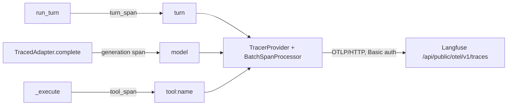

# Flow: tracing

**Summary.** With the `tracing` flag on, every chat turn becomes one trace and each model call and tool call inside it a span, with inputs, outputs, tokens, cost and time. Spans are plain OpenTelemetry, exported over OTLP/HTTP to a self-hosted Langfuse in Docker, so prompts that hold finance data stay on this machine. With the flag off, or the Langfuse keys missing, nothing is recorded and the helpers cost nothing.

## Worked example

`ka serve` with `tracing: true` and `LANGFUSE_PUBLIC_KEY`/`LANGFUSE_SECRET_KEY` in `.env`. The app lifespan calls `setup_tracing` (`server/tracing.py`), which builds a private `TracerProvider` (not the global one: OpenTelemetry lets the global be set once, which tests would trip over) with an `OTLPSpanExporter` pointed at `LANGFUSE_BASE_URL` (default `http://localhost:3000`) plus `/api/public/otel/v1/traces`, a Basic header from the two keys and `x-langfuse-ingestion-version: 4` (without it Langfuse can take minutes to show new data). `create_app` wraps both adapter factories with `traced_factory`, so every model call anywhere — chat, private chain, extraction, suggestions, intake, loops — passes through `TracedAdapter`. A question runs `run_turn`, which opens `turn_span` and puts the user id and conversation id in a context variable; each child span copies them as `langfuse.user.id` and `langfuse.session.id`, so Langfuse can filter by either. The model span is a `generation` with `gen_ai.request.model`, `gen_ai.usage.input_tokens`/`output_tokens`, cached tokens and `gen_ai.usage.cost` when the provider reports it. Inputs and outputs are capped at 20,000 characters.

## Post-build setup (owner)

1. `git clone https://github.com/langfuse/langfuse.git`, edit every `# CHANGEME` secret in `docker-compose.yml`, `docker compose up -d` (Langfuse v4: web, worker, Postgres, ClickHouse, Redis, MinIO; UI on port 3000).
2. Create a project, copy its public and secret keys into `.env` as `LANGFUSE_PUBLIC_KEY`, `LANGFUSE_SECRET_KEY`; set `LANGFUSE_BASE_URL` if not on port 3000.
3. Set `tracing: true` in `config.yaml` and restart `ka serve`.

## Why this way

- **Plain OpenTelemetry, not the Langfuse SDK.** Vendor-neutral spans; Langfuse reads `gen_ai.*` and `langfuse.*` attributes. Switching backends is an endpoint change.
- **Wrap the adapter, not each call site.** One class covers every model call, now and later.
- **Self-hosted.** LangSmith self-hosting needs an enterprise plan; Langfuse runs free in Docker.

## Failure cases

| Case | Result |
|---|---|
| Flag off or keys missing | `setup_tracing` returns False; spans are no-ops |
| Langfuse down | the batch exporter drops spans after its retries; chat is unaffected |
| Very long chat | span text capped at 20,000 characters |

Source: `server/tracing.py`, `server/agent/loop.py`, `server/api/app.py`, `server/cli.py`
