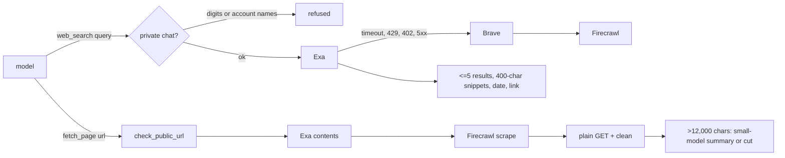

# Flow: web search and page reading

**Summary.** Two core tools behind the `web_search` flag let Ka handle questions about the outside world: `web_search` returns up to five short highlights, each with a title, link and date, and `fetch_page` reads one public page as cleaned text. Providers are tried in order (Exa, Brave, Firecrawl for search; Exa, Firecrawl, then a plain GET for pages), each with its own timeout, and Ka says plainly when all of them fail. Every result is untrusted outside text, so risky tools are blocked for the rest of that turn.

## Worked example

"Is the new Villeneuve film on Netflix in Canada?" The model calls `web_search` (`server/toolkits/core/web.py`). Outside a finance chat the query goes straight to `providers.web_search` (`server/web/providers.py`), which tries each configured provider (`providers_from_env` skips any without its key in `.env`: `EXA_API_KEY`, `BRAVE_SEARCH_API_KEY`, `FIRECRAWL_API_KEY`). Exa (`server/web/exa.py`) posts to `/search` with `numResults` and `contents.highlights.maxCharacters: 400`; a timeout (8 s) or an HTTP error falls through to Brave (`/res/v1/web/search`, `X-Subscription-Token`, its `page_age` gives the date) and then Firecrawl (`/v2/search`). Results are cut to five and snippets to 400 characters. The tool message reaches the model wrapped in `<untrusted source="web_search">`. If the model wants the page, `fetch_page` first checks the URL is http(s) and resolves to a public address (no loopback, LAN, link-local), then tries Exa `/contents`, Firecrawl `/v2/scrape` and a plain GET (redirects followed by hand, each hop re-checked; only globally routable addresses) whose HTML is stripped of scripts, menus and footers (`server/web/clean.py`). A page over 12,000 characters is summarised by the `small` model (the private chain in a finance chat, or just cut when there is none). On the next owner message, `compact_history` replaces these results with a placeholder in what the model sees.

## Why this way

- **Little by default.** Highlights, not pages, keep each call cheap; a full page only on request.
- **Three providers.** Free tiers run out; independent indexes fail differently.
- **Nothing personal leaves in a finance chat.** Queries go to outside companies, so a query or a page URL with four or more digits or an account label or bank name is refused there.
- **Raw results never become memory.** Saving needs `remember` (blocked after untrusted content) or `propose_memory` (owner approval).

## Failure cases

| Case | Result |
|---|---|
| No key configured | `no web search provider configured (add a key to .env)` |
| All providers fail | `web search unavailable: exa: timeout; brave: HTTP 429; ...` |
| Private or local URL | refused before any request |
| Personal query in a finance chat | `query looks personal; rephrase it without amounts or account names` |

Source: `server/web/*`, `server/toolkits/core/web.py`, `server/agent/context.py`
